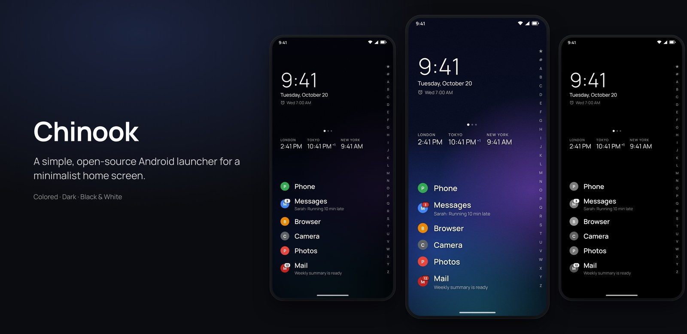
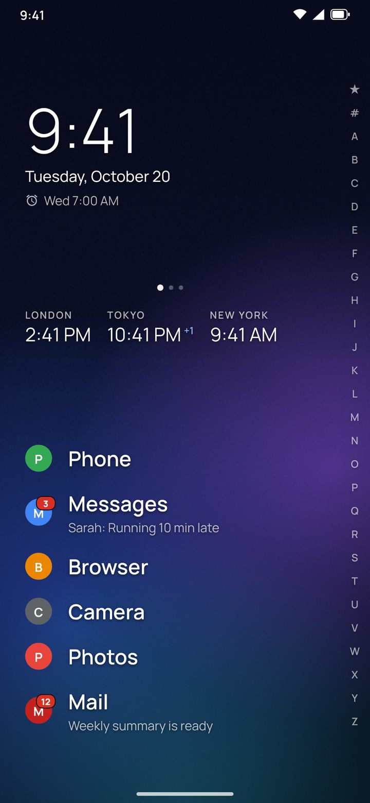
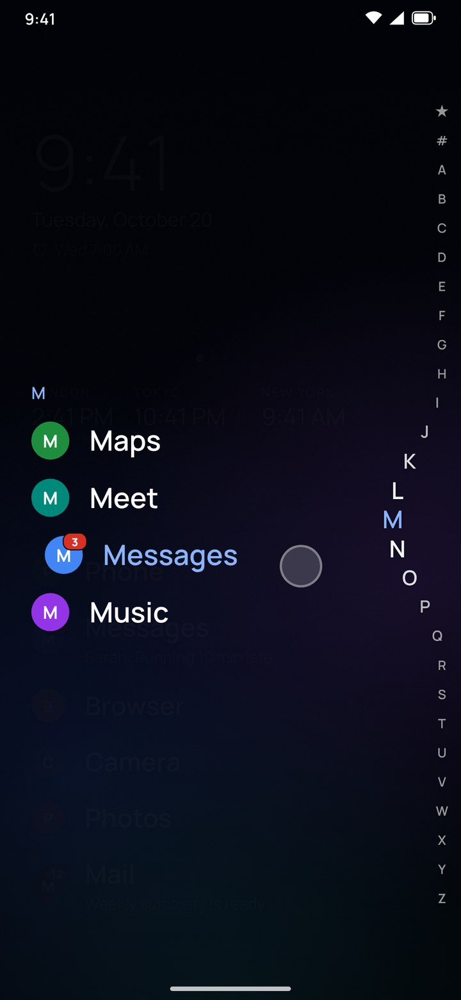
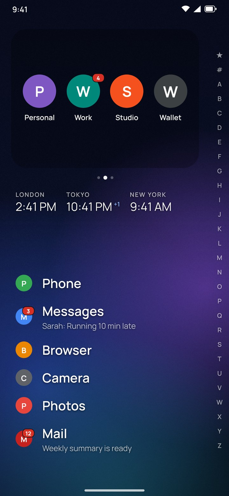
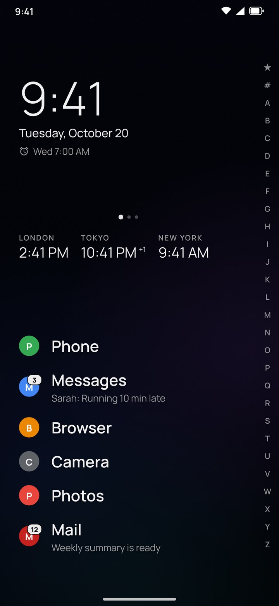
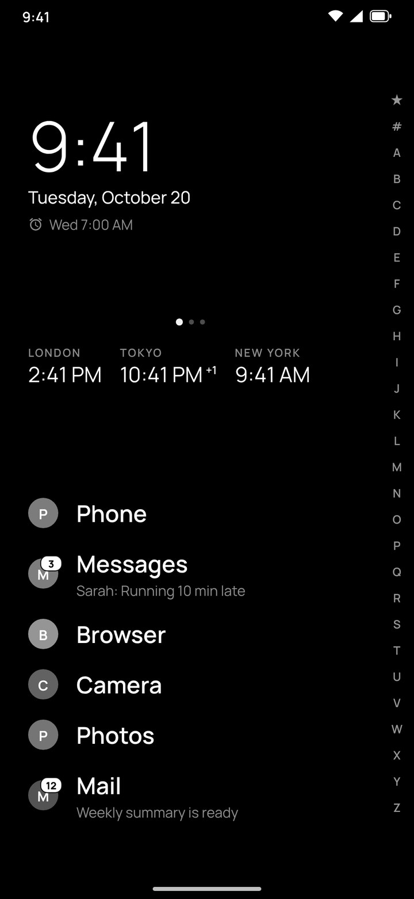
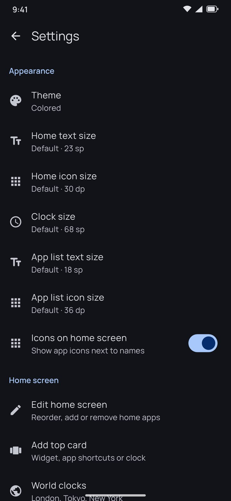
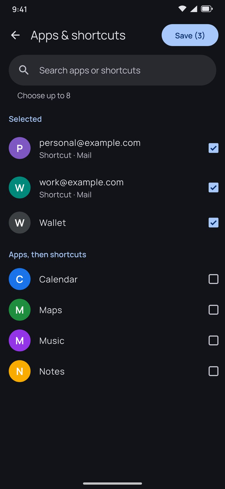
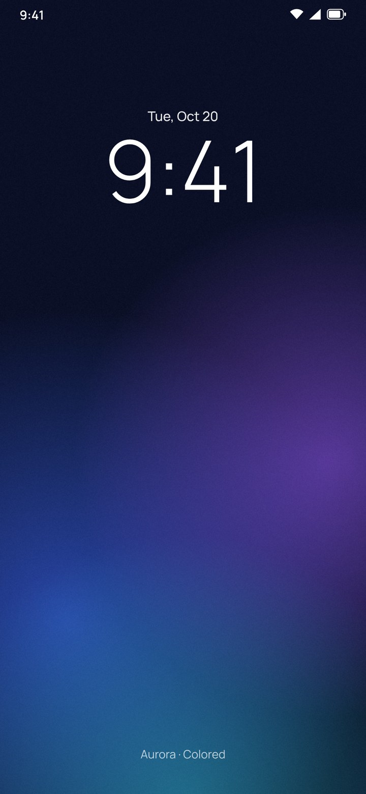
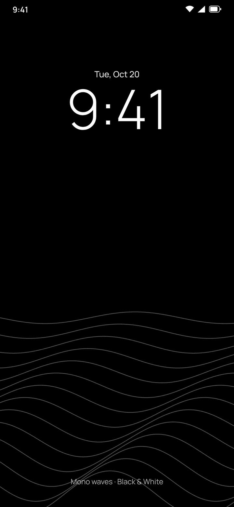

# Chinook Launcher

**Chinook is a simple Android launcher that lets you run a minimalist home screen.** Your apps
become a calm list of names you can reach with one thumb, everything else is one swipe away, and
you choose the look: **Colored**, **Dark** or **Black & White**.

It's free and open source, written from scratch in plain Java with only Android framework APIs:
no ads, no tracking, no account, and no internet permission. The whole app is under 300 KB.



> The images on this page are accurate previews generated from Chinook's own layouts, colours,
> font and icons (see [`docs/previews`](docs/previews)), shown with neutral placeholder app icons.
> They aren't photos of a phone screen, so your icons, wallpaper and system bars will look like
> your own.

## A quick look

| Home (Colored) | Letter pop-out | Top cards |
|:---:|:---:|:---:|
|  |  |  |
| Clock, world clocks and your home apps, with unread badges and message previews | Slide along the letters; the apps for that letter appear beside your finger | Swipe between your clock, widgets and app cards |

| Dark | Black & White | Settings |
|:---:|:---:|:---:|
|  |  |  |
| Dimmed wallpaper, muted greys | Pure black, greyscale icons and widgets | Android-style settings with sizes shown for every option |

| Search pickers | Lock screen: Aurora | Lock screen: Mono waves |
|:---:|:---:|:---:|
|  |  |  |
| Every "add" list has search, sections and a live count | Generated wallpapers for each theme | Android still draws the lock-screen clock |

## Features

### Home screen
- **Home apps as a list.** Big, readable names placed low on the screen, within thumb reach.
  Optional icons, with adjustable text, icon and clock sizes for the home screen and the app list.
- **Top card slider.** Swipe the top of the screen between cards: the **clock** (time, date, next
  alarm), any **widget** (weather, calendar, wallet, music…), and **app cards** holding up to 8
  apps or app shortcuts, such as one tile per Gmail account showing its profile picture. With three
  or more cards it loops endlessly. Widgets get their exact size, and app-card icons scale to fill
  the card.
- **World clocks.** A row of cities just under the cards, with +1 / −1 when it's a different day.
- **Notification badges and previews.** Unread counts on every app, and the newest message under
  your home apps (needs notification access; a guide walks you through it).

### Finding apps
- **Alphabet strip.** ★ (your home apps), #, then A–Z down the right edge. Slide along it and the
  letters ripple outward while that letter's apps appear beside your finger. Slide onto one and let
  go to open it.
- **Search.** Swipe up. Results are ranked by how well they match, hidden apps still turn up
  dimmed, and if nothing matches you can search the web.
- **App menu.** Long-press any app for its shortcuts, add or remove from home, add its shortcuts to
  a top card, app info, hide or unhide, and uninstall.

### Looks
- **Three themes.** *Colored* uses your wallpaper with Material You colours on Android 12+.
  *Dark* dims the wallpaper and uses muted greys. *Black & White* is pure black for AMOLED screens,
  with greyscale icons and widgets.
- **Lock screen designs.** Ten generated wallpapers (Aurora, Dusk, Ocean, Graphite, Midnight, Dark
  waves, Pure black, Mono waves, Horizon, Mono grain) with an optional note line, for the lock
  screen or both screens.
- **Android-native menus.** Material 3 bottom sheets, an Android-Settings-style settings page,
  full-screen search pickers and the official Material icons.

### Organising
- **Edit mode.** Reorder or remove home apps and add apps, cards and clocks from one bar.
- **Hidden apps.** Keep rarely used apps out of the list; unhide them from the end of the app list,
  the home menu, Settings, or by searching for them.
- **Work profile** apps are included with their badge, and the list updates as you install or
  remove apps.

For a full walkthrough of every gesture and menu, see the **[User guide](docs/USER_GUIDE.md)**.

## Install

1. Download `ChinookLauncher.apk` from the [Releases](../../releases) page, or build it yourself
   (below).
2. Open it on your phone and allow installing from your browser or file manager if asked.
3. Open Chinook. It asks to become your home app; you can also choose it later in
   *Settings → Apps → Default apps → Home app*.

Requires Android 8.0 or newer.

## Permissions

| Permission | Why |
|---|---|
| See installed apps (`QUERY_ALL_PACKAGES`) | To list and launch your apps. |
| Expand status bar | So swiping down on the home screen opens your notifications. |
| Request uninstall | For the *Uninstall* item in the app menu (Android still asks you to confirm). |
| Set wallpaper | Only used when you apply a lock screen design. |
| Notification access *(optional)* | For unread badges and message previews. Nothing leaves your phone. |

Chinook has **no internet permission**, so it can't send anything anywhere.

Notification access is a *special app access*, so App info → Permissions shows "No permissions
requested". That's expected. On Android 13+, apps installed from an APK must first be allowed
*restricted settings* (App info → ⋮ → *Allow restricted settings*). Chinook's setup guide walks you
through both steps.

## Build from source

No Gradle or Android Studio needed. On Debian or Ubuntu:

```sh
sudo apt install openjdk-21-jdk aapt apksigner zipalign dalvik-exchange
./build.sh
```

`build.sh` downloads an API-34 `android.jar` into `sdk/` if it's missing, compiles resources with
`aapt`, Java with `javac`, dexes with `dx`, then zipaligns and signs the APK. The first build creates
a signing key in `keystore/` (not committed). Keep it: Android only installs updates signed with
the same key.

### Project layout

```
AndroidManifest.xml
build.sh                      build without Gradle
assets/fonts/                 Manrope (SIL Open Font License)
res/                          theme, colours, launcher icon, Material icons
src/app/chinook/launcher/
  MainActivity.java           home screen, letter pop-out, drawer, edit mode, menus, settings
  TopCards.java               top card slider: clock, widget and app/shortcut cards
  CardPager.java              endless horizontal pager
  WidgetBinder.java           widget host: pick, bind, configure
  WidgetHostView.java         widget view that catches long-press
  AlphabetScrollerView.java   the ★ / # / A–Z wave strip
  AppRepository.java          loads apps for all profiles, watches for changes
  AppInfo.java                app model (label, icon, section, search key)
  NotificationDotService.java optional notification listener for badges and previews
  LockScreenDesigner.java     lock screen wallpaper designs
  SearchablePicker.java       full-screen searchable single/multi-select picker
  Surfaces.java               Material 3 bottom sheet and full-screen page
  M3.java                     Material 3 colours, type scale, buttons, list items, controls
  Theme.java                  Colored / Dark / Black & White palettes
  WorldClocks.java            time zones, names, day offsets
  Prefs.java, Fonts.java      settings storage, fonts
docs/
  USER_GUIDE.md               feature walkthrough
  screenshots/                README images
  previews/                   the HTML/Playwright generator for those images
```

## Credits and license

Chinook is released under the [MIT License](LICENSE).

- Font: [Manrope](https://github.com/sharanda/manrope), SIL Open Font License (`assets/fonts/OFL.txt`).
- Icons: [Material Icons](https://github.com/google/material-design-icons), Apache License 2.0.

Chinook is an independent project and isn't affiliated with Google or any other launcher.
