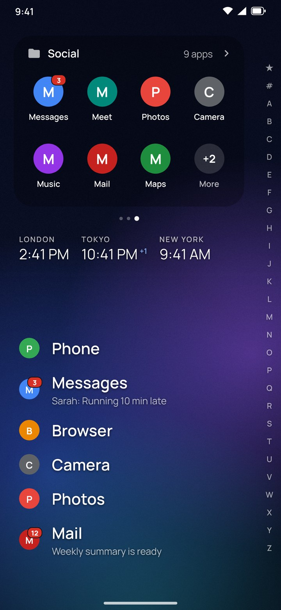
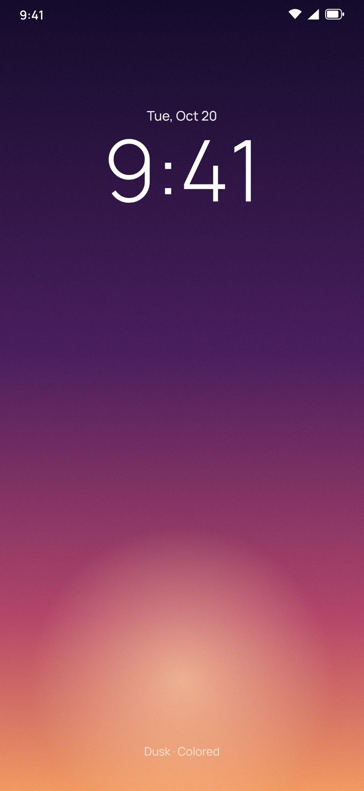
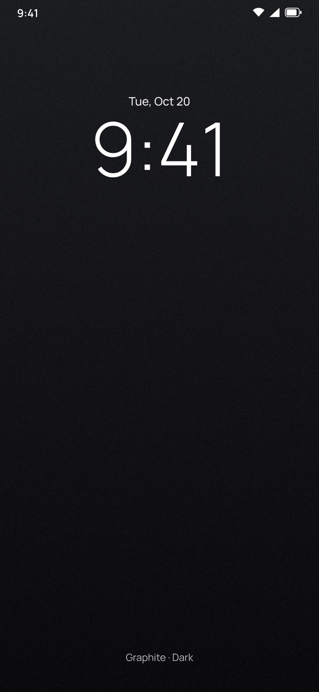
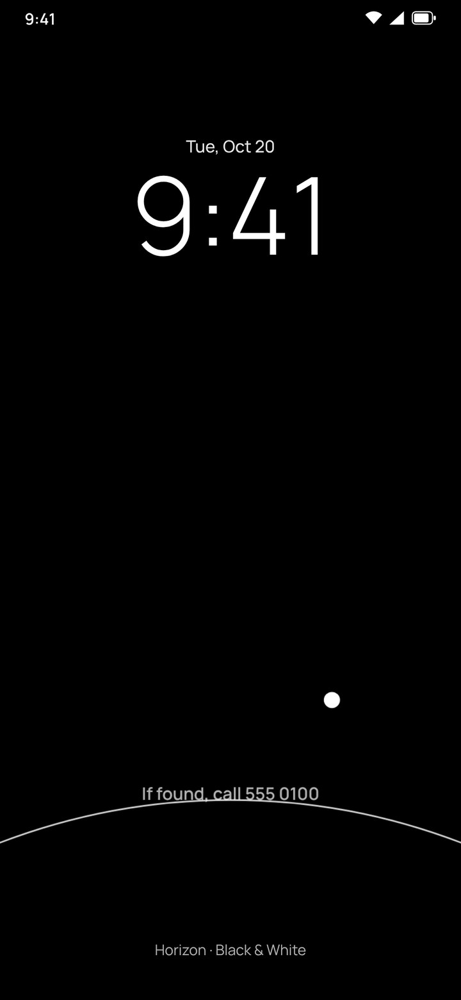

# Chinook user guide

Chinook keeps your home screen simple: a clock and a few cards at the top, the apps you use most
as a list at the bottom, and everything else one swipe away. This guide covers every gesture,
menu and setting.

- [Gestures at a glance](#gestures-at-a-glance)
- [The home screen](#the-home-screen)
- [Top cards](#top-cards)
- [Folders](#folders)
- [Finding and opening apps](#finding-and-opening-apps)
- [Customising the home screen](#customising-the-home-screen)
- [Notification badges and previews](#notification-badges-and-previews)
- [Themes, sizes and fonts](#themes-sizes-and-fonts)
- [Lock screen designs](#lock-screen-designs)
- [Hidden apps](#hidden-apps)
- [Cloned and work apps](#cloned-and-work-apps)
- [Settings reference](#settings-reference)
- [Troubleshooting](#troubleshooting)

> Images are previews generated from Chinook's own layouts with placeholder app icons, not photos
> of a phone screen.

## Gestures at a glance

| Gesture | Where | What it does |
|---|---|---|
| Slide along the letters | Right edge | Shows that letter's apps beside your finger |
| Slide onto an app and let go | After sliding the letters | Opens the app |
| Swipe up | Home screen | Opens the app list with search |
| Swipe down | Home screen | Opens your notifications |
| Swipe sideways | Top cards | Moves between cards (loops with 3+ cards) |
| Tap the clock / date / alarm | Clock card | Opens Clock / Calendar / alarms |
| Long-press empty space | Home screen | Home menu: edit, cards, clocks, theme, lock screen, settings |
| Long-press an app | Anywhere | App menu: shortcuts, home, top card, info, hide, uninstall |
| Long-press a card or tile | Top cards | Card menu: choose apps, move, height, remove |
| Back / Home | Anywhere in Chinook | Closes the open list or menu |

## The home screen

From top to bottom:

1. **Top cards.** Starts with the clock card: time, date and your next alarm. Dots underneath show
   which card you're on.
2. **World clocks.** Any cities you've added, with their local time. A small **+1** or **−1** means
   it's already tomorrow, or still yesterday, there. Tap the row to manage cities.
3. **Home apps.** Your favourites as a list of names, low on the screen so your thumb reaches them.
   Unread counts appear as small badges on the icon's corner, and the newest message shows under
   the app's name.
4. **Alphabet strip.** ★, #, then A–Z down the right edge.

 

## Top cards

The top of the home screen is a row of cards you swipe between. Add as many as you like; with
three or more, swiping loops endlessly.

**Card types**

- **Clock:** time, date and next alarm.
- **Widget:** any widget on your phone, such as weather, calendar, Google Wallet or music. Chinook
  tells the widget its exact card size, so widgets that adapt fill the card.
- **Apps & shortcuts:** up to 8 tiles. A tile can be an app or a shortcut from inside an app, such
  as each of your Gmail accounts (with its profile picture), a WhatsApp chat, or Maps directions
  home. The grid and icon size adapt to the number of tiles.

**Adding a card:** long-press empty space → *Add top card*, or use *Top card* in edit mode.

**Adding shortcuts like Gmail accounts:** long-press the app (e.g. Gmail) → *Add shortcuts to a top
card*, tick the ones you want, then pick an existing app card or *New card*. Chinook pins shortcuts
you place on cards, so they keep working even if the app reshuffles its shortcut menu. Shortcuts
need Chinook to be your default home app.

**Changing a card:** long-press it (or any tile on it) for *Choose apps & shortcuts*, *Move left /
right*, *Add card*, *Card height* and *Remove card*. On a tile you also get *Remove from card*.

 

## Folders

Folder cards keep a group of apps together in the top slider, with any number of apps.

- **Create one:** long-press empty space → *Add top card* → **Folder**. Start with an **empty
  folder** (name it, then pick apps), or tap a **suggestion**. Chinook groups your apps by the
  category Android gives them (Social, Productivity, Music & audio, Games, Maps & navigation…).
- **On the card:** the folder's name, its app count, and as many apps as fit. If there are more,
  the last tile shows **+N**.
- **Open the whole folder:** tap the name or **+N**. A sheet shows every app, with **Edit apps**
  and **Rename**.
- **Change it:** long-press the name or any app for *Open folder*, *Rename folder*, *Choose apps &
  shortcuts*, *Remove from card*, move, height and *Remove card*.
- **Shortcuts** (like a Gmail account) can go in folders too, through *Choose apps & shortcuts* or
  an app's *Add shortcuts to a top card*.

Folders from your phone's original launcher can't be imported: each launcher keeps its folders
in its own private storage, which Android doesn't let other apps read. The suggestions make
rebuilding them quick.

 

## Finding and opening apps

**Alphabet strip.** Put your thumb on the letters at the right edge and slide. The letters ripple
outward and that letter's apps appear beside your finger, with a tick of vibration on each letter.

- Slide left onto an app and let go to open it.
- Let go on the strip to keep the list open, then tap.
- **★** lists your home apps; **#** lists apps that start with a number or symbol.

**App list and search.** Swipe up anywhere. Start typing to filter: names that start with your text
come first, then words that start with it, then any match. Press *Go* to open the top result, or
use *Search the web* when nothing matches. Hidden apps still turn up when you search, dimmed.

 

## Customising the home screen

Long-press empty space → **Edit home screen**. Each home app gets ↑ ↓ ✕ buttons, and a bar appears
with:

- **Apps:** tick which apps are on your home screen (with search). The order you tick them is the
  order they appear.
- **Top card:** add a widget, an apps & shortcuts card, or the clock.
- **Clock:** manage world clocks.
- **Done:** leave edit mode.

You can also long-press any app → *Add to home* / *Remove from home*.

**World clocks:** tap the world clock row, or long-press empty space → *World clocks*. *Add city*
opens a search by city, region or GMT offset. Reorder or remove cities on the same page.

## Notification badges and previews

Chinook can show how many unread notifications each app has, and the newest message under your
home apps. For that, Android needs you to grant **notification access**. Chinook only reads
notifications on your phone, and it has no internet permission.

Chinook offers a setup guide the first time. You can open it any time: long-press empty space →
*Notification badges*, or *Settings → Apps → Notification badges*. It shows live status and walks
you through:

1. **Allow restricted settings** (Android 13+, only for apps installed from an APK): open App info,
   tap ⋮ in the top corner, then *Allow restricted settings*.
2. **Turn on notification access:** switch Chinook on and confirm.

The guide reopens each time you come back until access is on, then confirms with "Notification
badges are on".

Good to know:

- App info → Permissions will still say "No permissions requested". Notification access is a
  special access, listed under *Settings → Apps → Special app access → Notification access*.
- The "Allow notifications" switch in App info → Notifications is unrelated: it lets Chinook post
  its own notifications, which it never does.
- Turn message previews off in *Settings → Apps → Message previews* if you'd rather just see counts.

## Themes, sizes and fonts

| Colored | Dark | Black & White |
|:---:|:---:|:---:|
|  |  |  |
| Your wallpaper, with Material You colours on Android 12+ | Wallpaper dimmed, muted greys | Pure black, greyscale icons and widgets |

Change the theme with long-press → *Theme*, or in Settings → Appearance.

**Sizes** (Settings → Appearance). Each option shows a preview and its exact size:

| Setting | Extra small | Small | Default | Large | Extra large |
|---|---|---|---|---|---|
| Home text size | 16 sp | 19 sp | 23 sp | 27 sp | 31 sp |
| Home icon size | 20 dp | 24 dp | 30 dp | 38 dp | 46 dp |
| Clock size | – | 52 sp | 68 sp | 84 sp | 100 sp |
| App list text size | 14 sp | 16 sp | 18 sp | 20 sp | 22 sp |
| App list icon size | 24 dp | 30 dp | 36 dp | 42 dp | 48 dp |

The letter pop-out follows the home sizes; the app list has its own. Long app names wrap onto a
second line instead of being cut off. You can also turn icons off on the home screen for a
text-only look.

**Font:** Manrope (default) or your phone's own font.

## Lock screen designs

| Aurora | Dusk | Graphite | Horizon | Mono waves |
|:---:|:---:|:---:|:---:|:---:|
|  |  |  |  |  |

Long-press empty space → *Lock screen*. Pick from ten designs (three Colored, three Dark, four
Black & White), add an optional note such as a contact number, then apply to the **lock screen** or
to **lock & home**. The designs keep the top half calm so the clock sits cleanly on them.

Android draws the lock-screen clock and shortcuts itself; change their style in your phone's
*Settings → Wallpaper & style*.

## Hidden apps

Hide apps you rarely use: long-press an app → **Hide**. Hidden apps leave the alphabet strip, the
app list and the pickers. To bring one back:

- swipe up and **search** for it, then long-press → **Unhide**, or
- scroll to the end of the app list → **Hidden apps**, or
- long-press empty space → **Hidden apps**, or *Settings → Apps → Hidden apps*.

The Hidden apps page has an **Unhide** button on each app and a **Hide apps** button to hide more.
Hiding an app also removes it from your home screen, so re-add it with *Edit home screen → Apps*
after unhiding.

## Cloned and work apps

If your phone runs a second copy of an app (Dual Messenger, Dual apps, App clone), or you have a
work profile, both copies appear in Chinook. The copy is labelled with Android's own wording where
it has one (for example "Work WhatsApp"), otherwise "(Clone)", and shows the profile badge on its
icon.

Each copy has **its own badge and message preview**, so a message on your second WhatsApp only
lights up that one. Some phones keep cloned apps in a space other launchers can't see; those
copies won't appear in Chinook.

## Settings reference

Long-press empty space → **Settings**.

| Section | Setting | Notes |
|---|---|---|
| Appearance | Theme | Colored, Dark, Black & White |
| | Home text & icon size, Clock size, App list text & icon size | With previews and exact sizes |
| | Icons on home screen | Text-only when off |
| | Font | Manrope or system |
| Home screen | Edit home screen | Reorder, add, remove home apps |
| | Add top card, Top card height | Height applies to every card |
| | World clocks | Add, reorder, remove cities |
| | Next alarm | Shows under the date |
| Apps | Message previews | Newest notification under home apps |
| | Notification badges | Setup guide while off, live status |
| | Hidden apps | Unhide or hide more |
| Wallpaper & lock screen | Lock screen, Wallpaper | |
| System | Default home app, About | |

## Troubleshooting

**Shortcuts or account tiles don't appear.** Android only shares app shortcuts with the default
home app. Make Chinook your home app in *Settings → System → Default home app*.

**Badges don't show.** Open the notification setup guide (long-press → *Notification badges*). If
its status says access is on but badges don't appear, try a new notification or restart the phone.
Some phones also need battery restrictions lifted for Chinook.

**A widget looks small in its card.** Some older widgets have a fixed size. Try a lower *Top card
height*, or a newer version of the widget.

**An app is missing.** It may be hidden: search for it, or check *Hidden apps*.

**Updating.** Install a newer APK over the old one; your settings are kept. It must be signed with
the same key as the version you have installed.
